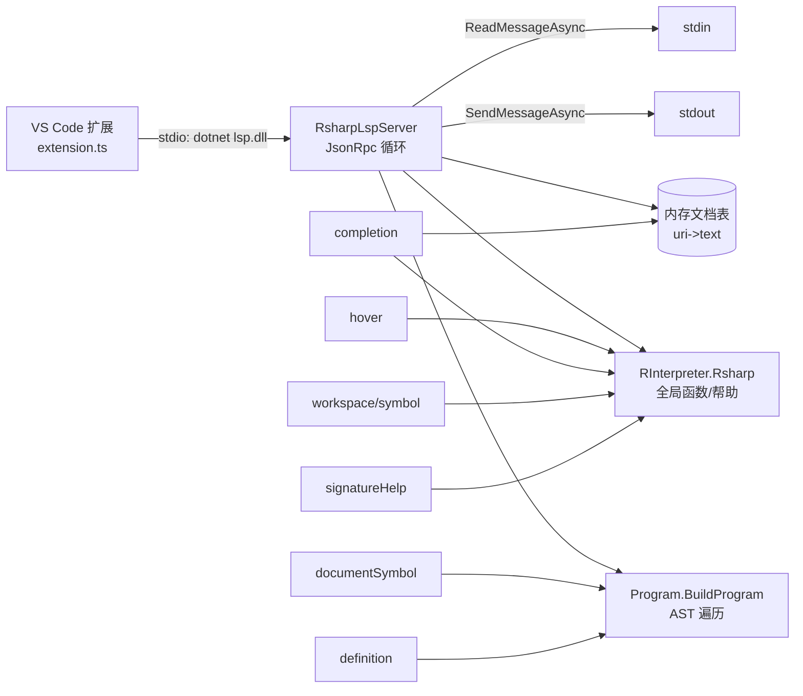

## 用户需求

在 `g:/mini-R/src/languageserver/` 工作区，为 R# 脚本语言实现一套面向 VS Code 的 Language Server Protocol（LSP）服务，复用现有 JSON-RPC 传输层与 R# 解释器环境组件。

## 产品概述

新增一个基于标准 LSP（stdio + JSON-RPC 分帧）的后台服务进程，由 VS Code 扩展以 `dotnet` 子进程方式启动；编辑器通过标准协议获得 R# 代码的智能提示能力。

## 核心能力（用户已确认范围）

- **Hover（悬浮提示）**：在符号上悬停时返回 markdown 帮助文档，复用 `R.globalEnvir.packages.packageDocs.PrintHelp`（RMethodInfo）与 `ConsoleMarkdownPrinter.getMarkdownDocs`（DeclareNewFunction）。
- **Completion（自动补全）**：基于 `R.globalEnvir.EnumerateAllFunctions` 去重函数名 + R# 语言关键词 + 当前文档内已声明符号，按光标处前缀过滤给出补全项。
- **documentSymbol（大纲）**：解析文档 AST，列出函数/lambda 声明作为层级符号。
- **definition（跳转定义）**：按符号名在已打开文档与全局函数中定位声明位置。
- **workspace/symbol（全局符号搜索）**：按查询字符串在 `EnumerateAllFunctions` 中做模糊/前缀匹配。
- **signatureHelp（参数提示）**：在调用处展示函数签名与参数列表。
- **明确不做**：`textDocument/publishDiagnostics` 语法诊断。
- **VS Code 插件**：仅最小启动器（`package.json` + `extension.ts` + `tsconfig.json`），不附带 TextMate 语法/语言配置。

## 技术栈

- 后端：VB.NET（net10.0），复用 `languageserver.vbproj` 已有的 `R#`（SMRUCC.Rsharp.*）、`JSON-netcore5`、`markdown` 引用，以及 `GCModeller/.../JsonRpc/JsonRpc.vb` 的 stdio JSON-RPC 传输（`languageserver.vbproj` 已间接引用 JSON 工程，JsonRpc 模块属于同一 JSON 程序集，可直接 `Imports`）。
- 命令行宿主：`src/lsp/lsp.vbproj`（Exe），引用 `languageserver.vbproj`。
- 前端插件：TypeScript + `vscode-languageclient`（node），stdio 方式拉起 `dotnet <lsp.dll>`。

## 实现方案

采用「单进程 JSON-RPC 服务器 + 内存文档缓存」架构：服务器从 `Console.OpenStandardInput` 逐帧读取请求，按 `method` 分派到各 Handler，结果用 `JsonRpc.SendMessageAsync(Console.OpenStandardOutput, ...)` 回写。**所有日志走 stderr 或文件**，绝不写 stdout，避免污染 LSP 分帧。R# 解释器环境（`RInterpreter.Rsharp`，`LoadLibrary("REnv", ignoreMissingStartupPackages:=True)`）在服务器构造时初始化一次并常驻，作为 hover/completion/workspace 符号的唯一数据源。

关键决策：

1. **传输层直接复用 JsonRpc 模块**：其 `ReadMessageAsync/SendMessageAsync` 已泛化到任意 `Stream`，stdio 即把 `Console.OpenStandardInput/Output` 传入，无需自制分帧；`MakeResponse/MakeError/MakeNotification` 已提供构建器。
2. **单词定位在服务器端完成**：`textDocument/hover`、`completion`、`definition` 请求只带 `position`，服务器从内存文档文本按 R# 标识符正则切出光标处单词（兼顾 `::`、`、`.` 等命名空间分隔符），避免依赖客户端发送精确 word。
3. **AST 遍历提取符号**：用 `Program.BuildProgram(text)` 解析当前文档，`Program` 即 `IEnumerable(Of Expression)`；遍历子节点收集 `DeclareNewFunction`（含 `funcName`/`parameters`/`stackFrame`）、`DeclareLambdaFunction`、`DeclareNewSymbol`，用于 documentSymbol 与 definition；遍历 `FunctionInvoke`/`SymbolReference` 收集引用名用于 definition 回查。
4. **补全候选缓存**：`EnumerateAllFunctions` 结果在环境初始化后缓存为去重名称列表（环境常驻、几乎不变），每次 completion 仅做前缀过滤，O(1) 取列表、O(n) 过滤；文档内声明符号每次实时解析（文档小，开销可忽略）。
5. **行列基准转换**：R# 的 `CodeSpan.line/start/stops` 为 1-based，LSP 位置为 0-based，统一在构造 `range` 时减 1（若实际为 0-based 则在实现时核对并去掉转换）。

## 实现要点（降低返工）

- `Main` 保持同步 `Function Main(args) As Integer`，内部 `server.RunAsync().GetAwaiter().GetResult()`，规避该 VB 编译器不识别 Async Main（BC30737）。
- 严格区分请求（有 id，必须回 `MakeResponse`）与通知（`initialized`/`exit` 无 id，不回响应）；`shutdown` 需回空结果后再 `exit` 退出。
- hover 文档生成严格复用 `LanguageServer.vb:75-137` 的 markdown 渲染路径（`MemoryStream` 捕获 `stdout` 输出），保证与现有 Web 服务一致。
- 解析失败（语法错误）时 completion/documentSymbol 优雅降级：返回空列表而非异常，保证编辑器不死。
- stdout 仅用于协议帧；调试信息写入 stderr。

## 架构设计



## 目录结构

```
src/languageserver/lsp/
└── RsharpLspServer.vb   # [NEW] LSP 服务器核心。实现 JsonRpc 主循环、方法分派、
                         #       initialize/initialized/shutdown/exit 生命周期；内存文档表；
                         #       hover/completion/documentSymbol/definition/workspace_symbol/
                         #       signatureHelp 六个 Handler；LSP JSON 构造辅助（position/range/
                         #       location/markupContent/completionItem/symbolInformation/
                         #       signatureInformation）。复用 RInterpreter 环境与 JsonRpc 模块，
                         #       日志写 stderr。
src/lsp/
├── Program.vb           # [MODIFY] 由占位 Hello World 改为：构造 RsharpLspServer 并
                         #       RunAsync().GetAwaiter().GetResult() 启动 stdio 服务。
└── vscode/
    ├── package.json     # [NEW] 扩展清单。engines.vscode、main=./out/extension.js、
    #       contributes.languages(R#)、contributes.configuration(rsharp.lsp.serverPath)、
    #       activationEvents(onLanguage:r)、dependencies: vscode-languageclient。
    ├── tsconfig.json    # [NEW] 编译 TS->out，target ES2020，module commonjs。
    └── src/extension.ts # [NEW] 用 LanguageClient 以 stdio 启动 `dotnet <lsp.dll>`
                         #       （路径读设置项 rsharp.lsp.serverPath，默认指向构建产物），
    #       注册 r 语言与各项 capability。
```

## 关键代码结构（参考契约）

```
' src/languageserver/lsp/RsharpLspServer.vb
Public Class RsharpLspServer
    Sub New(Optional trace As TextWriter = Nothing)
    Async Function RunAsync() As Task                  ' 主循环：读 stdin 帧 -> Dispatch -> 写 stdout
    Private Async Function Dispatch(msg As jsobj) As Task
    ' Handlers：返回 jsobj 结果（请求）或 Nothing（通知）
    Private Function OnInitialize(params As jsobj) As jsobj
    Private Function OnHover(params As jsobj) As jsobj
    Private Function OnCompletion(params As jsobj) As jsobj
    Private Function OnDocumentSymbol(params As jsobj) As jsobj
    Private Function OnDefinition(params As jsobj) As jsobj
    Private Function OnWorkspaceSymbol(params As jsobj) As jsobj
    Private Function OnSignatureHelp(params As jsobj) As jsobj
End Class
```