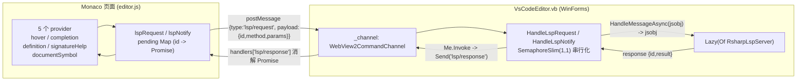

## Product Overview

在已有的 WinForms + WebView2 + Monaco 编辑器（`g:/mini-R/src/RDev/VsCodeEditor.vb`）中，接入现有 R# 语言服务器（`g:/mini-R/src/languageserver/src/languageserver/lsp/RsharpLspServer.vb`），使编辑器具备 R# 脚本的智能编辑能力。采用**进程内**接入（不启子进程），编辑器前端注册 Monaco 语言提供器，宿主把请求转发给进程内的 R# LSP 服务器并回推结果。

## Core Features

- **Hover 悬停帮助**：光标停留函数/符号上时，展示签名、参数、returns 或 markdown 帮助文档。
- **Completion 自动补全**：输入前缀或触发字符（`(` `.`  `` `:`）时，列出全局 R# 函数、语言关键字、当前文档内符号。
- **Definition 跳转定义**：在函数调用处触发跳转，定位到当前文档内的顶层函数定义行。
- **SignatureHelp 参数提示**：在 `(` `,` 后显示函数签名与当前参数索引高亮。
- **DocumentSymbol 大纲**：支持 `Ctrl+Shift+O` 快速大纲，列出文档内顶层函数名与行范围。
- **编辑内容同步**：打开文档与内容变更（150ms 防抖、全文同步）实时推送给语言服务器，保证上述能力基于最新文本。
- 不做语法诊断（`publishDiagnostics`），不接工作区符号。

## 使用与视觉表现

- 视觉上完全沿用编辑器现有 Monaco 外观（`vs` 主题、`language: 'r'`），新增能力以原生 IntelliSense/悬停/大纲/跳转的悬浮窗与下拉列表形式呈现，不改动页面布局。
- 交互上：悬停即出帮助卡片；输入即出候选列表；`F12` 跳定义；`print(` 出参数提示；`Ctrl+Shift+O` 出符号大纲。

## Tech Stack Selection

- **语言服务器**：VB.NET（`net10.0`），沿用现有 `languageserver.vbproj`，不引入新依赖。
- **编辑器宿主**：VB.NET WinForms（`net10.0-windows`）+ Microsoft.Web.WebView2（`RDev.NET5.vbproj`），新增对 `languageserver.vbproj` 的 `ProjectReference`。
- **编辑器前端**：Monaco Editor（内嵌 zip 资源），纯 JavaScript（AMD），不使用 `monaco-languageclient`、不使用 WebSocket。
- **传输/协议**：复用 `Microsoft.VisualBasic.MIME.application.json.JsonRpc`（Content-Length 分帧 JSON-RPC 工具方法）；页面与宿主之间复用 `Galaxy.WebViewHelper.WebView2CommandChannel`（`PostWebMessageAsJson` 双向 `{type, payload}`）。

**核心决策与理由**：用户已确认"进程内"方案。进程内可直接共享 `RInterpreter.Rsharp` 单例，符号表与既有 `DescriptionTooltip.vb` 的 R# 使用天然一致，且无需部署/管理额外 exe、无进程启动延迟。代价是需要对服务器做一次**向后兼容**的传输解耦（现 `RunAsync` 硬编码 `Console`）。

## Implementation Approach

分三层改动，最小化爆炸半径：

1. **服务器传输解耦（向后兼容）**：`RunAsync()` 从"读写进程控制台"改为"读写可注入流"；把现有私有 `Dispatch`（处理消息 + 写 stdout 耦合）拆成公共的传输无关入口 `HandleMessageAsync(msg) As Task(Of jsobj)`（返回待回发响应，通知返回 `Nothing`）与薄壳 `Dispatch`（await 后写流）。`lsp/Program.vb` 与 stdio 链路行为完全不变。
2. **Monaco 前端补齐 LSP 接线**：`editor.js` 目前既无 LSP provider 也无 LSP 消息，需新增 `lsp/request`、`lsp/notify`、`lsp/response` 三类消息，加一层基于自增 id + `Map` 的 Promise 桥，注册 5 个 provider，并做 LSP↔Monaco 的**位置基准**（0-based vs 1-based）与**枚举值**（SymbolKind/CompletionItemKind 不一致）双向映射，最后补 `didOpen`/`didChange` 文档同步（服务器 `textDocumentSync=1` 全文同步）。
3. **宿主进程内转发**：`VsCodeEditor.vb` 新增 `Lazy(Of RsharpLspServer)` 惰性实例 + `SemaphoreSlim` 串行化（R# 解释器非线程安全），在 `OnWebMessageReceived` 增加 `lsp/request` / `lsp/notify` 两个分支，把页面参数原样构造 JSON-RPC 消息调用服务器，取回 `result` 后用 `System.Text.Json.JsonElement` 原样透传回页面。

**性能与可靠性**：

- 每次请求为 **O(文档行数)**（关键词/前缀扫描）或 **O(AST)**（`Program.BuildProgram` 解析），无网络/进程往返开销，单次毫秒级。
- 瓶颈在 `Program.BuildProgram` 的解析成本与 R# 解释器的全局状态 → 用后台线程 + `SemaphoreSlim(1,1)` 串行化，避免阻塞 UI 线程与并发踩踏；`Lazy` 保证服务器只构造一次。
- 回包走 `JsonElement.Clone()` 透传，规避 `JsonSerializerOptions.Web` 命名策略对键名的潜在改写。

**扩展性**：`HandleMessageAsync` 成为传输无关的统一入口，后续再接 `references`/`rename`/`formatting` 只需在服务器 `Select Case` 与前端各加一个 provider，无需改传输层；宿主转发逻辑对方法名透明，新增能力零改动。

## Implementation Notes

- **UI 线程约束**：`WebView2CommandChannel.Send` 内部调用 `PostWebMessageAsJson`，必须在 UI 线程；后台线程算完后统一用 `Me.Invoke(...)` 回推，否则抛异常。
- **线程安全**：R# 解释器 + `RInterpreter.Rsharp` 单例不可并发，所有请求/通知在 `SemaphoreSlim(1,1)` 内执行。
- **`RedirectOutput` 副作用**：服务器构造函数会把解释器输出重定向到 stderr，会影响宿主自身 R# 输出；GUI 无控制台时 `Console.OpenStandardError` 可能不可用，需用 Try/Catch 容错，并让宿主传入 `TextWriter.Null` 或自定义日志 writer 作为 `trace`。
- **位置/枚举映射为硬约束**：Monaco `Position` 为 1-based、LSP 为 0-based；Monaco `SymbolKind.Function=11` 而 LSP `SymbolKind.Function=12`；`CompletionItemKind` 3→1 / 6→4 / 14→12 / 2→0。任一处遗漏都会导致整体错位或图标错误。
- **必须先 `didOpen`**：服务器 hover/definition/completion 依赖 `docs(uri)` 缓存，未 `didOpen` 一律返回空；在 `EditorReady` 后立即 `didOpen`。
- **向后兼容**：`lsp/Program.vb` 不改；单参构造 `New RsharpLspServer(trace)` 必须保留（`Program.vb` 依赖它）。`Select Case` 各 `Case` 分支在 VB 中拥有独立声明空间，新增分支可重复声明 `Dim payloadEl`（与现有 `TextChanged`/`IsDirtyChanged`/`Languages` 一致）。
- **环境前提**：本机曾实测 `G:/etc/r_env/library/REnv/` 缺 `webKit.dll` 导致 `Program.BuildProgram` 产生乱码 AST（`documentSymbol` 名字异常），属环境缺失而非代码缺陷，验收时需保证 REnv 完整。

## Architecture Design



- **服务器层**：`RsharpLspServer` 保持单例、单线程消费；`HandleMessageAsync` 为传输无关入口，stdio 宿主 (`lsp.vbproj`) 与进程内宿主 (RDev) 共用。
- **宿主层**：仅做"协议搬运 + 线程编组 + 串行化"，不包含任何语言逻辑（DRY，避免与服务器重复实现）。
- **前端层**：仅做"provider 适配 + 位置/枚举映射"，不包含语言逻辑。

## Directory Structure

本次改动跨两个仓库目录，均为既有项目的增量修改：

```
g:/mini-R/src/
├── languageserver/src/
│   ├── languageserver/lsp/
│   │   └── RsharpLspServer.vb        # [MODIFY] 传输解耦：新增 inputOverride/outputOverride 字段；
│   │                                 #   构造函数拆为 New(trace) 链式调用 New(input, output, trace)，
│   │                                 #   其中 RedirectOutput 包 Try/Catch；RunAsync 用注入流；
│   │                                 #   把 Dispatch 拆为公共 HandleMessageAsync(msg) As Task(Of jsobj)
│   │                                 #   （Task.FromResult 返回响应/Nothing，避免 BC42358）+ 薄壳 Dispatch；
│   │                                 #   exit 分支改为置 shutdownRequested=True；Case Else 改记 failCode/failMessage。
│   └── lsp/
│       └── Program.vb                # [UNCHANGED] stdio CLI 入口，行为与编译结果不变。
└── RDev/
    ├── RDev.NET5.vbproj              # [MODIFY] ItemGroup 新增
    │                                 #   <ProjectReference Include="..\languageserver\src\languageserver\languageserver.vbproj" />
    ├── VsCodeEditor.vb               # [MODIFY] 顶部加 Imports languageserver；
    │                                 #   字段加 Lazy(Of RsharpLspServer) + SemaphoreSlim(1,1)；
    │                                 #   Load 末尾创建 Lazy 并后台预热；
    │                                 #   OnWebMessageReceived 新增 Case "lsp/request" / Case "lsp/notify"；
    │                                 #   新增 HandleLspRequest / HandleLspNotify 两个转发方法
    │                                 #   （GetRawText 取参 -> MakeRequest/MakeNotification -> HandleMessageAsync
    │                                 #    -> JsonElement.Clone 透传 -> Me.Invoke 回推 / 异常回 error）。
    └── vscode/
        ├── editor.js                 # [MODIFY] Incoming 增 LspResponse、Outgoing 增 LspRequest/LspNotify；
        │                             #   新增 LSP 桥（lspSeq/lspPending/lspRequest/lspNotify/handleLspResponse）；
        │                             #   位置与 Kind 映射工具；注册 5 个 provider（language 'r'）；
        │                             #   handlers 追加 [Incoming.LspResponse]；
        │                             #   updateTextChanged 追加 syncDidChange()；EditorReady 后追加 syncDidOpen()。
        └── lspclient.vb              # [DELETE] 端口型死代码（假设 --port/--vscode，与本方案无关）。
```

## Key Code Structures

以下两处接口契约为核心，需精确定义（其余为标准模式，文字描述即可）：

```
' RsharpLspServer.vb —— 传输无关的公共入口，stdio 与进程内两条链路共用
Public Function HandleMessageAsync(msg As jsobj) As Task(Of jsobj)
    ' 返回：请求 -> JsonRpc.MakeResponse / MakeError 对象；通知 / 无需回包 -> Nothing
```

```js
// editor.js —— 页面与宿主之间的两条消息契约
// 页 -> 宿主：{ type: "lsp/request",  payload: { id, method, params } }   // 需回包
// 页 -> 宿主：{ type: "lsp/notify",   payload: { method, params } }       // 通知，不回包
// 宿主 -> 页：{ type: "lsp/response", payload: { id, result | error } }  // 消解/拒绝 Promise
```

## Agent Extensions

### SubAgent

- **code-explorer**
- **Purpose**: 在动手重构前，跨仓库（`g:/mini-R/src/languageserver`、`g:/mini-R/src/RDev`、`g:/galaxy/src/WebViewHelper`、`g:/GCModeller/src/runtime/sciBASIC#/mime/application%json/JsonRpc`）核对 `RsharpLspServer`、`WebView2CommandChannel`、`JsonRpc` 的全部调用点，确认没有其它宿主（如 RStudio studio / Notebook 相关工程）依赖将被改动的构造函数签名或 `Dispatch` 私有行为。
- **Expected outcome**: 输出一份"调用点清单 + 兼容性结论"，明确除 `lsp/Program.vb` 外是否还有其它消费者；若存在，列出必须保留的签名与行为，确保传输解耦零回归。